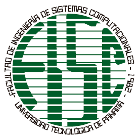

<div style="display: flex; justify-content: space-between; align-items: flex-start; width: 100%;">
  
  
</div>

<h3 align="center">UNIVERSIDAD TECNOLÓGICA DE PANAMÁ</h3>

<p align="center">
  Facultad de Ingeniería Eléctrica<br>
  Asignatura: Desarrollo de Web<br>
  Laboratorio de OpenSSL<br>
  <strong>Profesora:</strong> Ing. Irina Fong<br><br>
  <strong>Integrantes:</strong><br>
  Vasti Legaspi<br>
  Gabriel Herrera<br><br>
  <strong>Fecha de entrega:</strong> 30 de octubre de 2026<br>
  <strong>Período académico:</strong> II semestre de 2026
</p>

---

# 📑 Índice
1. [📖 Introducción](#1-introducción)
2. [🎯 Objetivos](#2-objetivos)
3. [💻 Descripción del proyecto](#3-descripción-del-proyecto)
4. [🖼️ Evidencias de ejecución](#4-evidencias-de-ejecución)
5. [🔐 Documentación técnica de las funciones](#5-documentación-técnica-de-las-funciones)
   - [📂 5.1. DiprenaGuardarAprobacion.php](#51-diprenaguardaraprobacionphp)
   - [🔒 5.2. Encriptacion.php](#52-encriptacionphp)
   - [✍️ 5.3. FirmarMensaje.php](#53-firmarmensajephp)
   - [ℹ️ 5.4. Informacion.php](#54-informacionphp)
   - [🔑 5.5. encriptacionOpenssl_2.php](#55-encriptacionopenssl_2php)
   - [📝 5.6. firma4.php](#56-firma4php)
   - [🛡️ 5.7. firma7.php](#57-firma7php)
   - [📜 5.8. firmaDigital.php](#58-firmadigitalphp)
   - [🏛️ 5.9. firmaDiprena.php](#59-firmadiprenaphp)
   - [🔏 5.10. firmaOtra.php](#510-firmaotraphp)
6. [🧪 Investigación sobre Libsodium](#6-investigación-sobre-libsodium)
7. [💭 Conclusiones personales](#7-conclusiones-personales)

---

# 1. 📖 Introducción

La criptografía es una herramienta fundamental para proteger la información en los sistemas informáticos, ya que permite implementar mecanismos de confidencialidad, integridad, autenticación y verificación de identidad.

PHP dispone de la extensión OpenSSL, que permite utilizar diferentes mecanismos criptográficos, como la generación de claves, la creación de certificados digitales, el cifrado de información y las operaciones relacionadas con firmas digitales.

En este proyecto se trabaja con funciones criptográficas implementadas en PHP mediante OpenSSL. Se documenta el propósito de cada función, sus parámetros, los valores que devuelve y el proceso criptográfico que realiza. Asimismo, se incluyen evidencias de ejecución y una investigación sobre la biblioteca Libsodium como alternativa para implementar operaciones criptográficas en PHP.

# 2. 🎯 Objetivos
Que el estudiante aplique el uso de la extensión OpenSSL y librerías criptográficas modernas en PHP, comprendiendo su propósito para proteger datos sensibles (según los lineamientos de cumplimiento de OWASP), mediante la ejecución de  ejemplos prácticos y el análisis de su documentación técnica.

# 3. 💻 Descripción del proyecto

El proyecto consiste en implementar y documentar funciones criptográficas mediante PHP y OpenSSL. Para ello, se analizan los scripts proporcionados, se identifica la finalidad de las operaciones criptográficas y se explica el funcionamiento de las funciones utilizadas.

Entre las operaciones que se documentan se encuentran la generación de claves, la creación de solicitudes de firma de certificados, la generación y exportación de certificados digitales y las operaciones de firma y cifrado que correspondan a los scripts del proyecto.

## 3.1. 🔩 Tecnologías utilizadas

- **PHP:** lenguaje de programación utilizado para implementar los scripts.
- **OpenSSL:** extensión y biblioteca criptográfica utilizada para realizar las operaciones correspondientes.
- **Libsodium:** biblioteca criptográfica investigada como parte del proyecto.
- **GitHub:** plataforma utilizada para almacenar y documentar el proyecto.

# 4. 🖼️ Evidencias de ejecución

En esta sección se deben incorporar las capturas de pantalla que demuestren la ejecución de los scripts y los resultados obtenidos.

Cada evidencia debe corresponder a una ejecución real del proyecto y permitir identificar qué función se está probando y cuál fue su resultado.

## Conceptos básicos (para entender el código)

Antes de ver cada formulario conviene entender las palabras que se repiten.

| Concepto | Qué es, en palabras simples |
|---|---|
| **Llave privada y llave pública** | Son un par de llaves matemáticas que van juntas. La **privada** es secreta y solo la tiene el dueño. La **pública** se puede repartir a cualquiera. Lo que se firma con la privada solo se puede comprobar con su pública. |
| **Hash (SHA-256)** | Una "huella digital" del mensaje: un resumen de tamaño fijo. Si cambias una sola letra del mensaje, la huella cambia por completo. |
| **Firma digital** | La huella del mensaje, protegida con la llave privada. Demuestra dos cosas: que el mensaje lo firmó el dueño de la llave y que nadie lo modificó después. |
| **Verificar** | Usar la llave pública para comprobar la firma. Si el mensaje o la firma cambiaron, la comprobación falla. |
| **Certificado X.509** | Un documento que une una llave pública con los datos de una persona u organización (nombre, país, vigencia). Es como una cédula digital. **Autofirmado** significa que se firma con su propia llave, sin una autoridad externa. |
| **CSR** | Solicitud de certificado. Es el "formulario" que se envía a una autoridad certificadora para que ella emita el certificado. |
| **Cifrado AES** | Mezcla el texto con una clave para que nadie lo pueda leer. Con la misma clave se vuelve a abrir. Aquí se usa **una sola clave** (no un par). |
| **Base64** | Una forma de convertir datos binarios (ilegibles) en texto normal, para poder mostrarlos y copiarlos. |
| **PEM** | El formato de texto en que se guardan llaves y certificados. Se reconoce por las líneas `-----BEGIN ...-----`. |
| **`openssl.cnf`** | Archivo de configuración de OpenSSL. En WAMP hay que indicarle a PHP dónde está, o no se pueden crear llaves. |

### Cómo están armados todos los formularios

Todos los archivos tienen la misma estructura, de arriba hacia abajo:

1. **Parte PHP (la lógica):** se ejecuta primero en el servidor. Lee lo que el usuario escribió en `$_POST`, lo valida, usa las funciones `openssl_*` y prepara una variable `$resultado`.
2. **Parte HTML (lo que se ve):** dibuja el formulario. Si existe `$resultado`, muestra el aviso verde o rojo.

Cada archivo comparte estas piezas:

- `$_POST['campo']`: lo que el usuario escribió en el campo con ese nombre.
- `trim(...)`: quita espacios sobrantes al inicio y al final.
- `$resultado = ['tipo' => 'ok' o 'error', 'titulo' => ..., 'detalle' => ...]`: guarda el mensaje que se mostrará.
- `e(...)`: función corta para escapar texto (`htmlspecialchars`). Evita que alguien escriba código HTML o JavaScript en un campo y se ejecute en la página.
- `name="accion" value="firmar"` en los botones: así el PHP sabe cuál botón se presionó (`$_POST['accion']`).
- Las funciones `openssl_*` son las que hacen el trabajo criptográfico. En cada formulario se explica cuáles se usan.

---

## 4.1. Evidencia de FirmaOtra

**Descripción:** En este apartado se muestra la ejecución del script `FirmaOtra` (`Form_FirmaOtra.php`) y el resultado obtenido al generar el certificado. El formulario crea un certificado X.509 autofirmado junto con su llave privada.

**Datos que solicita:** nombre común y país (obligatorios), organización, localidad, correo y vigencia en días (de 1 a 3650).

**Resultado esperado:** aviso verde «Certificado creado», con el titular, las fechas de vigencia, el algoritmo, la huella SHA-256 y el certificado en formato PEM. Los archivos `certout.crt` y `privkey.pem` quedan guardados en `keysCert/<nombre>/`.

**Captura de pantalla:**


**Cómo funciona el código, paso a paso:**

1. **Busca `openssl.cnf`.** Hay una lista `$candidatos` con varias rutas posibles. Un `foreach` prueba cada una con `file_exists` y usa la primera que existe. Esa ruta se guarda en `$config['config']`.
2. **Define la configuración de la llave:** `private_key_bits => 2048` (tamaño de la llave), `private_key_type => OPENSSL_KEYTYPE_RSA` (tipo de llave) y `digest_alg => 'sha256'` (huella).
3. **Prepara la carpeta `keysCert/`.** Si no existe, la crea y dentro pone un `.htaccess` con `Require all denied` para que nadie pueda descargar las llaves desde el navegador.
4. **Lee y valida lo que escribió el usuario.** Si algo está mal (nombre inválido, país que no son 2 letras, correo mal escrito, días fuera de rango), llena `$resultado` con un error y no sigue.
5. **Arma `$dn`.** Es la "identidad" del titular: país, localidad, organización, nombre común y correo. Con `array_filter` se quitan los campos vacíos.
6. **Crea el certificado en tres funciones encadenadas:**

   ```php
   $pkey = openssl_pkey_new($config);                       // 1) crea el par de llaves
   $csr  = openssl_csr_new($dn, $pkey, $config);            // 2) crea la solicitud con los datos del titular
   $cert = openssl_csr_sign($csr, null, $pkey, $dias, $config); // 3) la firma
   ```

   El `null` del tercer paso significa "no hay otra autoridad": el certificado se firma con su propia llave. Por eso se llama **autofirmado**.
7. **Convierte todo a texto PEM** con `openssl_x509_export` (certificado) y `openssl_pkey_export` (llave privada).
8. **Guarda los archivos** con `file_put_contents` en `keysCert/<nombre>/`: `certout.crt` (certificado) y `privkey.pem` (llave privada). El nombre de carpeta se limpia (sin tildes ni espacios) para que sea seguro.
9. **Muestra los datos del certificado.** `openssl_x509_parse` lee las fechas de vigencia y `openssl_x509_fingerprint` calcula la huella SHA-256.

---

## 4.2. Evidencia de Firma7

**Descripción:** En este apartado se muestra la ejecución del script `Firma7` (`Form_Firma7.php`) y el resultado obtenido. El formulario genera un par de llaves RSA por usuario, firma un mensaje con la llave privada y lo verifica con la llave pública.

**Datos que solicita:** usuario (de 3 a 30 caracteres), mensaje y, de forma opcional, la casilla para generar llaves nuevas.

**Resultado esperado:** al firmar, aviso verde «Mensaje firmado» con la llave pública y la firma en Base64. Al verificar, aviso «Firma válida» si el mensaje no cambió, o «Firma inválida» si fue alterado. Los archivos se guardan en `keys/<usuario>/`.

**Captura de pantalla:**


**Cómo funciona el código, paso a paso:**

1. **Configura OpenSSL y la carpeta `keys/`** igual que en FirmaOtra.
2. **Valida el usuario** con una expresión regular: `/^[A-Za-z0-9_-]{3,30}$/`. Solo permite letras, números, guion y guion bajo. Esto evita que alguien escriba algo como `../` para guardar archivos fuera de `keys/`.
3. **Si se presionó «Firmar»:**
   - Si el usuario no tiene llaves (o se marcó «Generar llaves nuevas»), las crea:

     ```php
     $par = openssl_pkey_new($configArgs);          // crea el par de llaves
     $det = openssl_pkey_get_details($par);         // de ahí se saca la llave pública: $det['key']
     openssl_pkey_export($par, $privPem, null, $configArgs); // saca la privada como texto
     ```

   - Guarda `private_key.pem` y `public_key.pem` en `keys/<usuario>/`.
   - Lee la llave privada con `openssl_get_privatekey` y firma:

     ```php
     openssl_sign($mensaje, $firma, $priv, OPENSSL_ALGO_SHA256);
     ```

     Esta función calcula la huella SHA-256 del mensaje y la protege con la llave privada. El resultado queda en `$firma` (la variable se llena "por referencia").
   - Guarda la firma en `signature.dat` y la muestra con `base64_encode` para que sea legible.
4. **Si se presionó «Verificar»:** lee la llave pública y la firma guardadas y usa:

   ```php
   openssl_verify($mensaje, $firma, $pub, OPENSSL_ALGO_SHA256) === 1
   ```

   La función devuelve `1` si la firma es válida, `0` si no coincide y `-1` si hubo un error. Si el mensaje tiene aunque sea una letra distinta, devuelve `0`.

---

## 4.3. Evidencia de FirmaMensaje

**Descripción:** En este apartado se muestra la ejecución del script `FirmaMensaje` (`Form_FirmaDigital.php`) y el resultado obtenido. El formulario firma un mensaje con la llave privada de un certificado ya creado y lo verifica con el certificado público.

**Datos que solicita:** certificado (lista de los que existen en `keysCert/`), mensaje y firma en Base64 (se llena sola al firmar; para verificar se pega la firma recibida).

**Resultado esperado:** al firmar, la firma en Base64 aparece en el cuadro correspondiente. Al verificar, aviso «Firma válida» con el nombre del titular del certificado, o «Firma inválida» si el mensaje fue modificado.

**Captura de pantalla:**


**Cómo funciona el código, paso a paso:**

1. **Busca los certificados disponibles.** La función `archivoCert()` revisa si una carpeta tiene `certout.crt` (o `certout.csr`). Con `glob()` se recorren las carpetas de `keysCert/` y solo se agregan a la lista `$disponibles` las que tienen **llave privada y certificado**. Esa lista llena el menú desplegable.
2. **Valida la elección.** Comprueba que el certificado elegido esté en `$disponibles`. Así nadie puede inventar una ruta de archivo desde el navegador.
3. **Lee el certificado** con `openssl_x509_parse` y toma el nombre común (`CN`) para saber a nombre de quién está.
4. **Si se presionó «Firmar»:** carga la llave privada del certificado (`openssl_pkey_get_private`), firma con `openssl_sign` y convierte la firma a Base64 para mostrarla.
5. **Si se presionó «Verificar»:**
   - Convierte la firma de Base64 a binario con `base64_decode` (con el modo estricto `true`, para detectar texto dañado).
   - Extrae la llave pública del certificado con `openssl_pkey_get_public($certPem)`.
   - Llama a `openssl_verify`. Con resultado `1` dice que el mensaje es auténtico y firmado por el titular. Con `0` avisa que fue modificado o que la firma es de otro certificado.

La diferencia con Firma7 es que aquí las llaves vienen de un **certificado** (que tiene nombre y vigencia), no de un par de llaves sueltas.

---

## 4.4. Evidencia de cifrado con OpenSSL

**Descripción:** En este apartado se muestra la ejecución del script de cifrado (`Form_Encriptacion.php`) y el resultado obtenido. El formulario cifra y descifra texto con AES-128-CBC a partir de una clave.

**Datos que solicita:** clave (mínimo 8 caracteres), mensaje y texto cifrado (se llena solo al cifrar; para descifrar se pega aquí).

**Resultado esperado:** al cifrar, aviso «Mensaje cifrado» con el texto cifrado en Base64. Al descifrar con la clave correcta, aviso «Mensaje descifrado» y el texto original en el cuadro Mensaje. Con una clave incorrecta, aviso «No se pudo descifrar».

**Captura de pantalla:**


**Cómo funciona el código, paso a paso:**

Aquí **no hay llaves públicas ni privadas**: se usa una sola clave, la que escribe la persona. El archivo tiene tres funciones:

1. **`derivarClave($clave, $sal)`:** AES necesita una clave de exactamente 16 bytes, y una contraseña escrita por una persona no tiene ese tamaño. Esta función usa `hash_pbkdf2` (100 000 repeticiones de SHA-256) para convertir la contraseña en una clave de 16 bytes. Las repeticiones hacen que adivinar contraseñas sea muy lento.
2. **`cifrar($texto, $clave)`:**
   - Crea una **sal** de 16 bytes aleatorios (`random_bytes`). Es un valor al azar que se mezcla con la contraseña.
   - Crea un **IV** de 16 bytes aleatorios. Es otro valor al azar que hace que el cifrado cambie cada vez.
   - Cifra con `openssl_encrypt(texto, 'AES-128-CBC', clave derivada, ..., iv)`.
   - Une todo en un solo paquete: `sal + iv + texto cifrado`, y lo pasa a Base64.
3. **`descifrar($paquete, $clave)`:**
   - Pasa el Base64 a binario y lo **corta en tres partes** con `substr`: los primeros 16 bytes son la sal, los siguientes 16 son el IV y el resto es el texto cifrado.
   - Vuelve a derivar la clave con la misma contraseña y la misma sal.
   - Descifra con `openssl_decrypt`. Si la contraseña es incorrecta, la función devuelve `false` y se muestra el error.

**Por qué sale distinto cada vez:** la sal y el IV son aleatorios, así que el mismo mensaje con la misma clave produce un resultado diferente cada vez que se cifra. Aun así se puede descifrar, porque la sal y el IV viajan dentro del paquete (no son secretos, lo secreto es la clave).

---

## 4.5. Evidencia de Firma4

**Descripción:** En este apartado se muestra la ejecución del script `Firma4` (`Form_Firma4.php`) y el resultado obtenido. El formulario genera una llave privada RSA y una solicitud de certificado (CSR).

**Datos que solicita:** nombre común (obligatorio), organización, departamento, ciudad, provincia o estado, país y correo.

**Resultado esperado:** aviso verde «Solicitud creada», con el CSR en pantalla y el enlace para descargar `request.csr`. Los archivos `private.key` y `request.csr` quedan en `keys/<nombre>/`.

**Captura de pantalla:**


**Cómo funciona el código, paso a paso:**

1. **Configura OpenSSL** buscando `openssl.cnf` y crea la carpeta `keys/` protegida, igual que los anteriores.
2. **Lee los siete campos** con un `foreach` sobre la lista `$campos` y los guarda en el arreglo `$v`.
3. **Valida** el nombre común, el país (2 letras) y el correo.
4. **Arma `$dn`** (los datos de identidad) quitando los campos vacíos.
5. **Genera la solicitud:**

   ```php
   $pkey = openssl_pkey_new($config);              // crea el par de llaves
   $csr  = openssl_csr_new($dn, $pkey, $config);   // crea la solicitud con la identidad
   openssl_csr_export($csr, $csrPem);              // la pasa a texto PEM
   openssl_pkey_export($pkey, $privPem, null, $config); // la llave privada a texto
   ```

6. **Guarda** `private.key` y `request.csr` en `keys/<nombre>/`.
7. **Ofrece la descarga** con un enlace `data:` que contiene el texto del CSR (`rawurlencode` lo prepara para ir dentro del enlace), así no hace falta crear otro archivo.

**Diferencia con FirmaOtra:** aquí se termina en la solicitud (`openssl_csr_new`). **No** se llama a `openssl_csr_sign`, porque quien debe firmarla y emitir el certificado es una autoridad certificadora externa.

---

## 4.6. Evidencia de FirmaDiprenaGuardar

**Descripción:** En este apartado se muestra la ejecución del script `FirmaDiprenaGuardar` (`Form_DiprenaAprobacion.php`) y el resultado obtenido. El formulario aprueba uno o más trámites de Diprena y firma los datos de cada cargo.

**Datos que solicita:** una o más filas con el id del trámite y su sello.

**Resultado esperado:** aviso verde «Aprobación firmada» y, en «Salida del proceso», la cadena generada, la firma en Base64 y la verificación de la firma.

**Captura de pantalla:**


**Cómo funciona el código, paso a paso:**

Aquí intervienen **tres archivos** que trabajan en cadena:

`Form_DiprenaAprobacion.php` (el formulario) → `DiprenaGuardarAprobacion.php` (la aprobación) → `firmaDiprena.php` (la firma).

**1. El formulario (`Form_DiprenaAprobacion.php`):**

- Los campos se llaman `id[]` y `sello[]`. Los corchetes hacen que PHP reciba **listas**, una posición por cada fila agregada.
- Recorre las dos listas a la vez y arma el arreglo `$validos` con la forma `[id => sello]`. El id debe ser número y el sello solo letras, números, guion y guion bajo.
- Entrega ese arreglo al script original con `$_REQUEST['aprobarDIPRENA'] = $validos;`, que es lo que ese script espera.
- Usa un truco para capturar la salida:

  ```php
  ob_start();                                   // empieza a "grabar" todo lo que se imprima
  include 'DiprenaGuardarAprobacion.php';       // ejecuta el script (que imprime con echo)
  $salida = ob_get_clean();                     // detiene la grabación y devuelve el texto
  ```

  Así lo que el script imprime no se ve suelto en la página, sino dentro del cuadro «Salida del proceso».
- Revisa si la salida contiene `la firma es valida` para decidir si el aviso es verde o rojo.
- El botón «+ Agregar trámite» usa un pequeño JavaScript que **clona** una fila vacía.

**2. `DiprenaGuardarAprobacion.php`:** por cada trámite de la lista (`foreach`):

- Consulta el trámite en la tabla `tramitescargo`. En esta versión de pruebas las funciones `mysql_*` están **simuladas**, devuelven datos de ejemplo, porque no hay base de datos conectada.
- Calcula los números de resuelto y de documento y hace el `UPDATE` (también simulado).
- Junta los datos del cargo (posición, salario, ocupación, identificación, nombres y apellidos) en **una sola cadena de texto** llamada `$datos`.
- Incluye `firmaDiprena.php` para firmar esa cadena.

**3. `firmaDiprena.php`:** lee `keys/private_key.pem` y `keys/public_key.pem`, firma `$datos` con `openssl_sign`, guarda la firma en `keys/signature<id>.dat`, imprime la firma en Base64 y la verifica con `openssl_verify`.

**Idea clave:** lo que se firma es la cadena con los datos del cargo. Si alguien cambia el salario o un nombre después, la firma deja de ser válida.

---

## 4.7. Evidencia de FirmaDiprena

**Descripción:** En este apartado se muestra la ejecución del script `FirmaDiprena` (`Form_FirmaDiprena.php`) y el resultado obtenido. El formulario firma y verifica los datos de un cargo con las llaves existentes en `keys/`.

**Datos que solicita:** id del cargo y datos a firmar.

**Resultado esperado:** al firmar, aviso «Mensaje firmado» con la firma en Base64, guardada en `keys/signature<id>.dat`. Al verificar, aviso «Firma válida» o «Firma inválida» según los datos coincidan con la firma guardada.

**Captura de pantalla:**


**Cómo funciona el código, paso a paso:**

1. **Lee los dos campos:** `idCargo` (reemplaza a la variable `$idCargoActual` del script original) y `datos` (reemplaza a `$datos`).
2. **Valida** que el id sea solo números con `ctype_digit`, que haya datos y que existan `keys/private_key.pem` y `keys/public_key.pem`. Este formulario **no crea llaves**: usa las que ya existen.
3. **Nombre del archivo de firma:** `keys/signature` + id + `.dat`. Por eso cada cargo tiene su propia firma (por ejemplo `signature1.dat`, `signature2.dat`).
4. **Si se presionó «Firmar datos»:**
   - Carga la llave privada con `openssl_get_privatekey`.
   - Firma con `openssl_sign($datos, $firma, $llavePrivada, OPENSSL_ALGO_SHA256)`.
   - Guarda la firma con `file_put_contents`.
   - La verifica enseguida con `openssl_verify` y la muestra en Base64.
5. **Si se presionó «Verificar firma»:** lee el archivo `signature<id>.dat` y comprueba que los datos escritos coincidan con esa firma. Si cambias una letra de los datos, el resultado es «Firma inválida».

---

## Resumen de las funciones `openssl_*` usadas

| Función | Para qué sirve |
|---|---|
| `openssl_pkey_new` | Crea un par de llaves (privada y pública). |
| `openssl_pkey_export` | Convierte la llave privada a texto PEM para guardarla. |
| `openssl_pkey_get_details` | Obtiene datos de la llave, entre ellos la llave pública. |
| `openssl_get_privatekey` / `openssl_pkey_get_private` | Carga una llave privada desde su texto PEM. |
| `openssl_pkey_get_public` | Carga una llave pública (por ejemplo, desde un certificado). |
| `openssl_sign` | Firma datos con la llave privada. |
| `openssl_verify` | Comprueba una firma con la llave pública. Devuelve `1` si es válida. |
| `openssl_csr_new` / `openssl_csr_export` | Crea y exporta una solicitud de certificado (CSR). |
| `openssl_csr_sign` | Firma una solicitud y crea el certificado. |
| `openssl_x509_export` / `openssl_x509_parse` / `openssl_x509_fingerprint` | Exporta un certificado, lee sus datos y calcula su huella. |
| `openssl_encrypt` / `openssl_decrypt` | Cifra y descifra texto con AES. |
| `openssl_error_string` | Devuelve el texto del último error de OpenSSL. Se usa para mostrar por qué falló algo. |

# 5. 🔐 Documentación técnica de las funciones

En esta sección se documentará cada uno de los 10 archivos PHP del proyecto. Para cada archivo se explicará qué hace el código, cómo funcionan las variables y las funciones utilizadas, cuáles son sus parámetros y qué resultados se obtienen durante su ejecución.

## 5.1. 📂 DiprenaGuardarAprobacion.php

En este archivo se procesa la aprobación de los trámites de DIPRENA. Lo que hace es consultar los trámites seleccionados, obtener sus datos, actualizar la información de aprobación en la base de datos y generar una réplica del cargo y de los datos personales. Al final, prepara la información que se va a firmar y llama al archivo `firmaDiprena.php`, donde se realiza el proceso de firma digital.

### 5.1.1. Incluir los archivos necesarios

Primero se incluyen varios archivos que contienen funciones y clases que necesita este código para funcionar. Por ejemplo, `Barricada.php`, `VariablesSesiones.php` y `utils.php`, además de los archivos relacionados con la conexión a la base de datos, los cargos, las réplicas, las fechas y las cadenas de texto.

Cada archivo aporta funciones o información que se utiliza en distintas partes del proceso.

```php
include("Barricada.php");
$menu01 = " id=\"current\"";

include("VariablesSesiones.php");
include("comunes/utils.php");

include("clases/conexionAdmin.php");
include("clases/objClase.php");
include("clases/obj_CargoReplica.php");

include("comunes/funcionObjeto.php");
include("comunes/getSiafaData.php");

//include("comunes/libreriaBitSocial.php");
include("comunes/librerias_fecha.php");
include("comunes/Libreria_String.php");
```

La línea que empieza con `//` está comentada, por lo que PHP no la ejecuta.

### 5.1.2. Obtener la fecha del sistema

Después definimos algunas variables que guardan la fecha actual. `$indicadorValue` se establece en `3`, mientras que `$FechaSistema`, `$anio_`, `$mes_` y `$dia_` almacenan la fecha en distintos formatos.

Esto sirve para registrar cuándo se aprobó el trámite y guardar por separado el día, el mes y el año.

```php
$indicadorValue = 3;
$FechaSistema = date("Y-m-d");
$anio_ = date("Y");
$mes_ = date("n");
$dia_ = date("j");
```

- `date("Y-m-d")`: obtiene la fecha completa, por ejemplo, `2026-10-26`.
- `date("Y")`: obtiene el año con cuatro dígitos.
- `date("n")`: obtiene el número del mes sin un cero inicial.
- `date("j")`: obtiene el día del mes sin un cero inicial.

### 5.1.3. Obtener los trámites seleccionados

En esta parte se obtiene el contenido de `aprobarDIPRENA` desde `$_REQUEST`. Después se crea el arreglo `$datosfirmados`, que se utilizará para almacenar o manejar los datos relacionados con la información que se va a firmar.

```php
$aprobarDIPRENA = $_REQUEST['aprobarDIPRENA'];

$datosfirmados = array();
```

La variable `$aprobarDIPRENA` contiene los trámites seleccionados para su aprobación. El código espera que pueda recorrerse como un arreglo.

### 5.1.4. Recorrer los trámites y consultar la base de datos

Ahora usamos `foreach` para recorrer cada trámite seleccionado. `$key` representa el identificador del trámite y `$value` contiene el valor asociado a ese identificador.

Por cada trámite se prepara una consulta SQL para buscar su registro en la tabla `tramitescargo`. Luego, `mysql_query()` ejecuta la consulta y `mysql_num_rows()` permite saber cuántos registros se encontraron.

```php
foreach ($aprobarDIPRENA as $key => $value) {

    $consultaTramitesRev = "select * from tramitescargo where id = '$key'";
    $sqlQueryTramitesRev = mysql_query($consultaTramitesRev);
    $numCargoRev = mysql_num_rows($sqlQueryTramitesRev);
```

De esta forma, el código puede trabajar con cada trámite por separado. Si se encuentra al menos un registro, continúa con el procesamiento.

### 5.1.5. Obtener los datos del trámite

Si la consulta encuentra registros, se utiliza `mysql_fetch_object()` para obtener uno de ellos como un objeto. Después se extraen tres datos: la naturaleza de la acción, la dependencia y la posición.

```php
    if ($numCargoRev > 0) {

        $regTramitesRev = mysql_fetch_object($sqlQueryTramitesRev);

        $tipoAccionRev = $regTramitesRev->NaturalezaAccion;
        $dependenciaRev = $regTramitesRev->Dependencia;
        $Posicion = $regTramitesRev->Posicion;
```

Estos valores se utilizan más adelante para consultar la jefatura correspondiente y actualizar los contadores relacionados con la aprobación.

### 5.1.6. Consultar la jefatura de Recursos Humanos

Después se utiliza `getSiafaData()` para buscar información en la tabla `roles`, filtrando por la dependencia, la excepción de rol y el estado activo. El identificador del resultado se guarda en `$idJefeRRHH`.

```php
        $regJefaturaRRHH = getSiafaData(
            "roles",
            "Dependencia = $dependenciaRev and ExcepcionRol = 2 and Activo = 1",
            "id"
        );

        $idJefeRRHH = $regJefaturaRRHH->id;
```

Con esto se obtiene el identificador de la jefatura de Recursos Humanos que corresponde según las condiciones de la consulta.

### 5.1.7. Actualizar los contadores

En esta parte se llaman tres funciones que actualizan o calculan los números relacionados con los trámites aprobados. Cada una recibe los datos necesarios para trabajar con el año, la dependencia, la posición o el tipo de acción.

```php
        $ResueltoPersonalNumero = actualizarResueltosPersonal(
            $dependenciaRev,
            $anio_
        );

        $NumeroPosicionAprobado = actualizarContadoresPosiciones2(
            $Posicion,
            $dependenciaRev,
            $anio_
        );

        $NumeroDocumentoAprobado = actualizarContadores(
            $tipoAccionRev,
            $dependenciaRev,
            $anio_
        );
```

Los resultados se guardan en variables para utilizarlos posteriormente. Por ejemplo, `$NumeroDocumentoAprobado` se incorpora en la actualización del trámite.

### 5.1.8. Actualizar la información de aprobación

Una vez obtenidos los datos necesarios, se ejecuta una consulta `UPDATE` para actualizar el registro de `tramitescargo`. Se guardan el sello de aprobación, el usuario que realiza la operación, la fecha, el indicador, el número del documento aprobado, la fecha del resuelto, la jefatura de Recursos Humanos y el número del resuelto personal.

```php
        mysql_query("update tramitescargo set Sello3 ='$value',
                 UsuarioDiprena = '$Usuario',
                 FechaDiprena = '$FechaSistema',
                 Indicador = $indicadorValue,
                 NumeroDocumentoAprobacion = '$NumeroDocumentoAprobado',
                 DiaResuelto = $dia_,
                 MesResuelto = $mes_,
                 AnioResuelto = $anio_,
                 idJefeRRHH = $idJefeRRHH,
                 ResueltoPersonal = '$ResueltoPersonalNumero'
                 where id='$key'");
```

La condición `where id='$key'` permite identificar el trámite que se está actualizando. De esta manera, la aprobación queda registrada en el registro correspondiente.

### 5.1.9. Generar las réplicas del cargo y los datos personales

Después de actualizar el trámite, se guarda su identificador en `$idCargoActual`. Luego se incluyen dos archivos: `ReplicaCargo.php` y `ReplicaDatosPersonales.php`.

```php
        $idCargoActual = $key;

        include("replicas/ReplicaCargo.php");
        include("replicas/ReplicaDatosPersonales.php");
```

Según los nombres de los archivos y su uso en este código, esta parte corresponde al proceso de réplica del cargo y de los datos personales asociados al trámite.

### 5.1.10. Preparar los datos que se van a firmar

Después se concatenan varios campos del arreglo `$datosfirmados`. Primero se unen la posición, el salario, los gastos de representación y la ocupación. Luego se agregan el número de resuelto personal, la identificación, el nombre y el segundo nombre. Por último, se añaden los apellidos.

```php
        $datosFirmar = $datosfirmados['Posicion']
            . $datosfirmados['Salario']
            . $datosfirmados['Gast_Representacion']
            . $datosfirmados['Ocupacion'];

        $datosFirmar2 = $datosfirmados['ResueltoPersonal']
            . $datosfirmados['Identificacion']
            . $datosfirmados['Nombre']
            . $datosfirmados['SegundoNombre'];

        $datosFirmar3 = $datosfirmados['Apellido']
            . $datosfirmados['SegundoApellido'];

        $datos = $datosFirmar . $datosFirmar2 . $datosFirmar3;
```

El resultado final se guarda en `$datos`, que es la variable que se utiliza como contenido para la firma digital. Es decir, se juntan los datos que se quieren proteger en un solo texto.

### 5.1.11. Llamar al archivo de firma digital

Finalmente, se incluye `firmaDiprena.php`, que es el archivo encargado de continuar con el proceso de firma digital utilizando los datos preparados anteriormente.

```php
        include("firmaDiprena.php");
```

Esto permite que la información del trámite pase al proceso de firma sin tener que escribir toda la lógica de la firma digital dentro de este mismo archivo.

### 5.1.12. Finalizar el recorrido y cerrar la conexión

Al terminar de procesar cada trámite, se cierran las estructuras del `if` y del `foreach`. Después se llama a `mysql_close($sql)` para intentar cerrar la conexión a la base de datos.

```php
    }

} // Fin del foreach

mysql_close($sql);

//redireccionar("Diprena.php");
?>
```

La línea `redireccionar("Diprena.php")` está comentada, así que no se ejecuta. Si se quisiera utilizar, habría que quitar los caracteres `//`.

---

## 5.2. 🔒 Encriptacion.php

En este código vamos a realizar un proceso de cifrado y descifrado utilizando OpenSSL. Primero tenemos un mensaje que queremos proteger, después lo ciframos utilizando el método AES-128-CBC y finalmente lo volvemos a descifrar para comprobar que podemos recuperar el mensaje original.

### 5.2.1. Definir la clave

Primero creamos la variable `$clave`, donde guardamos el texto que vamos a utilizar como clave para cifrar y descifrar el mensaje. En este caso, la clave tiene 17 caracteres, aunque el comentario original indica 16. Para AES-128 se necesitan 16 bytes de clave; OpenSSL puede ajustar la clave proporcionada según sus reglas, pero lo recomendable es utilizar una clave del tamaño adecuado.

```php
$clave = "clave123456789012"; // Clave utilizada para el cifrado
```

### 5.2.2. Generar el vector de inicialización (IV)

Después generamos el IV, que es un valor que se utiliza junto con el método AES-128-CBC durante el cifrado. Primero usamos `openssl_cipher_iv_length()` para obtener la longitud que necesita ese método y luego `openssl_random_pseudo_bytes()` para generar el valor aleatorio.

```php
$iv = openssl_random_pseudo_bytes(
    openssl_cipher_iv_length("AES-128-CBC")
);
```

Este IV también se necesita al momento de descifrar el mensaje, por eso lo conservamos en la variable `$iv`.

### 5.2.3. Definir el mensaje original

Aquí creamos la variable `$texto`, donde guardamos el mensaje que queremos proteger. En este ejemplo, el texto es `"Mensaje secreto"`.

```php
$texto = "Mensaje secreto";
```

### 5.2.4. Cifrar el mensaje

En esta parte usamos `openssl_encrypt()` para cifrar el mensaje. La función recibe el texto original, el método de cifrado, la clave, las opciones y el IV. El resultado queda guardado en `$cifrado`.

```php
$cifrado = openssl_encrypt(
    $texto,
    "AES-128-CBC",
    $clave,
    0,
    $iv
);
```

El valor `0` indica que el resultado se devuelve codificado en Base64, lo que facilita mostrarlo como texto. Aunque se vea como una cadena, el mensaje ya está cifrado y no se puede leer directamente como el original.

### 5.2.5. Mostrar el resultado del cifrado

Después usamos `echo` para mostrar el resultado del cifrado en pantalla. El operador `.` permite unir el texto del mensaje con el contenido de la variable `$cifrado`, y `<br>` agrega un salto de línea en la página.

```php
echo "el resultado del cifrado es el siguiente " . $cifrado . "<br>";
```

### 5.2.6. Descifrar el mensaje

Ahora hacemos el proceso contrario utilizando `openssl_decrypt()`. Le pasamos el texto cifrado, el mismo método, la misma clave, las mismas opciones y el mismo IV. Si todo funciona correctamente, recuperamos el mensaje original y lo guardamos en `$descifrado`.

```php
$descifrado = openssl_decrypt(
    $cifrado,
    "AES-128-CBC",
    $clave,
    0,
    $iv
);
```

Es importante utilizar la misma clave y el mismo IV que se usaron para cifrar el mensaje. Si alguno de estos valores no coincide, el descifrado puede fallar o devolver datos incorrectos.

### 5.2.7. Mostrar el resultado del descifrado

Por último, mostramos el contenido de `$descifrado` para comprobar que se recuperó el mensaje original.

```php
echo "el resultado del descifrado es: " . $descifrado . "<br>";
```

## 5.3. ✍️ FirmarMensaje.php

En este archivo vamos a trabajar con la firma digital de un mensaje. Primero utilizamos la clave privada que se generó anteriormente para firmar el mensaje y después usamos el certificado público para comprobar si esa firma es válida. Así podemos verificar si el mensaje corresponde con la firma generada y si pudo haber sido modificado.

### 5.3.1. Definir el mensaje

Primero creamos la variable `$mensaje`, donde guardamos el texto que queremos firmar. En este caso, el mensaje es `"Este es un mensaje confidencial"` y será el que utilizaremos durante todo el proceso.

```php
$mensaje = "Este es un mensaje confidencial";
```

### 5.3.2. Cargar la clave privada

Después usamos `file_get_contents()` para leer la clave privada desde el archivo `privkey.pem`, que se encuentra dentro de la carpeta `keysCert`. Luego utilizamos `openssl_pkey_get_private()` para cargar esa clave y convertirla en un formato que OpenSSL pueda utilizar.

```php
$privateKey = file_get_contents('keysCert/privkey.pem');
$privKeyResource = openssl_pkey_get_private($privateKey);
```

Esta clave es importante porque es la que vamos a utilizar para generar la firma digital. Por eso, debe mantenerse protegida y no compartirse con otras personas.

### 5.3.3. Firmar el mensaje

Aquí usamos `openssl_sign()` para generar la firma digital del mensaje. La función recibe el texto, guarda la firma generada en `$firmaBinaria`, utiliza la clave privada y aplica el algoritmo SHA-256.

```php
openssl_sign($mensaje, $firmaBinaria, $privKeyResource, OPENSSL_ALGO_SHA256);
```

Con esto obtenemos una firma que después podemos utilizar para comprobar que el mensaje no haya sido alterado.

### 5.3.4. Convertir la firma a Base64

Como la firma se genera en formato binario, usamos `base64_encode()` para convertirla en una cadena de texto que sea más fácil de almacenar o enviar. El resultado se guarda en `$firmaBase64`.

```php
$firmaBase64 = base64_encode($firmaBinaria);
```

### 5.3.5. Mostrar la firma generada

Después utilizamos `echo` para mostrar la firma en Base64. De esta manera podemos ver el resultado que se generó al firmar el mensaje.

```php
echo "Firma en base64:\n" . $firmaBase64;
```

### 5.3.6. Cargar el certificado público

Ahora pasamos a la parte de verificación. Primero leemos el archivo `certout.csr` desde la carpeta `keysCert` y después usamos `openssl_pkey_get_public()` para obtener la clave pública que se utilizará para verificar la firma.

```php
$cert = file_get_contents('keysCert/certout.csr');
$pubKeyResource = openssl_pkey_get_public($cert);
```

La clave pública permite verificar la firma sin necesidad de compartir la clave privada. Sin embargo, el archivo debe contener un certificado válido o una clave pública en un formato que OpenSSL pueda reconocer.

### 5.3.7. Recuperar la firma original

Como anteriormente convertimos la firma a Base64, ahora usamos `base64_decode()` para volver a convertirla a formato binario. Esto es necesario porque `openssl_verify()` trabaja con la firma binaria.

```php
$firmaBinaria = base64_decode($firmaBase64);
```

### 5.3.8. Verificar la firma digital

En esta parte utilizamos `openssl_verify()` para comprobar la firma. Se le pasan el mensaje original, la firma en formato binario, la clave pública y el algoritmo SHA-256. El resultado se guarda en la variable `$ok`.

```php
$ok = openssl_verify($mensaje, $firmaBinaria, $pubKeyResource, OPENSSL_ALGO_SHA256);
```

La función devuelve diferentes valores dependiendo del resultado de la verificación. Por eso, en el siguiente bloque revisamos qué valor se obtuvo.

### 5.3.9. Mostrar el resultado de la verificación

Por último, usamos una estructura `if`, `elseif` y `else` para mostrar un mensaje dependiendo del resultado.

- Si `$ok === 1`, la firma es válida para el mensaje.
- Si `$ok === 0`, la firma no es válida para ese mensaje.
- Si se obtiene otro resultado, ocurrió un error durante la verificación y se muestra el mensaje de OpenSSL.

```php
if ($ok === 1) {
    echo "✅ Firma válida. El mensaje no fue alterado.";
} elseif ($ok === 0) {
    echo "❌ Firma inválida. El mensaje pudo haber sido modificado.";
} else {
    echo "⚠ Error al verificar la firma: " . openssl_error_string();
}
```

### 5.3.11. En resumen

Con este código aprendimos cómo firmar un mensaje utilizando una clave privada y después verificar esa firma con la clave pública. De esta manera podemos comprobar si la firma corresponde al mensaje que recibimos. Si el mensaje cambia después de haber sido firmado, la verificación debería fallar.

**Importante:** para que el proceso funcione, el archivo `keysCert/privkey.pem` debe contener la clave privada y `keysCert/certout.csr` debe contener un certificado válido o un formato que permita obtener la clave pública. Aunque el archivo tenga la extensión `.csr`, esa extensión normalmente se utiliza para solicitudes de certificado; si contiene el certificado generado, sería más apropiado guardarlo con una extensión como `.crt` o `.pem`. Además, en un programa real conviene comprobar que las funciones de lectura, carga y firma no hayan fallado antes de continuar.

---

## 5.4. ℹ️ Informacion.php

En este archivo vamos a utilizar una función de PHP que nos permite ver información sobre la configuración del lenguaje en nuestro servidor. Esto nos sirve para revisar qué versión de PHP tenemos instalada, qué extensiones están habilitadas y otros detalles que pueden ser útiles cuando estamos trabajando con OpenSSL.

### 5.4.1. Abrir el bloque de PHP

Primero utilizamos `<?PHP` para indicar que a partir de ahí comienza el código PHP que se va a ejecutar en el servidor.

```php
<?PHP
```

### 5.4.2. Mostrar la información de PHP

Después utilizamos `phpinfo()`, una función que muestra información detallada sobre la instalación y configuración de PHP. Entre otras cosas, podemos consultar la versión instalada, las extensiones disponibles y algunos parámetros de configuración del servidor.

```php
phpinfo();
```

### 5.4.3. Cerrar el bloque de PHP

Finalmente, utilizamos `?>` para indicar que termina el bloque de código PHP.

```php
?>
```

## 5.5. 🔐 encriptacionOpenssl_2.php

En este código vamos a trabajar con el cifrado de información utilizando OpenSSL. Lo que hacemos es cifrar un mensaje, generar un código para comprobar su integridad y finalmente juntar los resultados para mostrarlos en una sola cadena. Para esto utilizamos AES-256-CBC, HMAC y Base64.

### 5.5.1. Preparar las claves

Primero creamos dos variables, `$first_key` y `$second_key`, donde usamos `base64_decode()` para decodificar los textos `"Irina"` y `"Fong"`. El resultado se guarda en cada variable para utilizarlas después durante el proceso.

```php
$first_key = base64_decode("Irina");
$second_key = base64_decode("Fong");
```

**Ojo:** `base64_decode()` no convierte cualquier texto en una clave segura. En este caso, los valores obtenidos no son adecuados para utilizarlos directamente como claves de AES-256 o HMAC.

### 5.5.2. Seleccionar el método de cifrado

Después indicamos el método de cifrado que vamos a utilizar. En este caso es `aes-256-cbc`, que utiliza AES con una clave de 256 bits y el modo CBC.

```php
$method = "aes-256-cbc";
```

### 5.5.3. Obtener la longitud del vector de inicialización

Aquí usamos `openssl_cipher_iv_length()` para conocer cuántos bytes necesita el vector de inicialización, también conocido como IV, según el método de cifrado seleccionado.

```php
$iv_length = openssl_cipher_iv_length($method);
```

### 5.5.4. Generar el vector de inicialización

Ahora generamos un IV aleatorio con `openssl_random_pseudo_bytes()`. Este valor se utiliza al cifrar el mensaje y después debe conservarse para poder descifrarlo correctamente.

```php
$iv = openssl_random_pseudo_bytes($iv_length);
```

### 5.5.5. Cifrar el mensaje

En esta parte ciframos el texto `"Hola como estas"` usando `openssl_encrypt()`. La función recibe el mensaje, el método de cifrado, la primera clave, la opción `OPENSSL_RAW_DATA` y el IV generado anteriormente. El resultado cifrado se guarda en `$first_encrypted`.

```php
$first_encrypted = openssl_encrypt(
    "Hola como estas",
    $method,
    $first_key,
    OPENSSL_RAW_DATA,
    $iv
);
```

La opción `OPENSSL_RAW_DATA` hace que el resultado se devuelva en formato binario, en lugar de codificarse automáticamente en Base64.

### 5.5.6. Generar el código de verificación HMAC

Después utilizamos `hash_hmac()` para generar un código de autenticación a partir del mensaje cifrado. En este caso usamos el algoritmo `sha3-512`, el resultado de cifrar el mensaje y la segunda clave. El último parámetro, `TRUE`, indica que el resultado se devuelve en formato binario.

Este código permite comprobar si los datos cifrados fueron modificados, siempre que se utilice una clave HMAC adecuada y se verifique correctamente al descifrar.

```php
$second_encrypted = hash_hmac(
    'sha3-512',
    $first_encrypted,
    $second_key,
    TRUE
);
```

### 5.5.7. Unir los resultados y codificarlos

Por último, juntamos el IV, el código HMAC y el mensaje cifrado mediante el operador `.`. Después usamos `base64_encode()` para convertir el resultado binario en una cadena de texto que sea más fácil de mostrar o guardar.

```php
$output = base64_encode($iv . $second_encrypted . $first_encrypted);
```

### 5.5.8. Mostrar el resultado

Finalmente, usamos `echo` para mostrar la cadena que contiene los datos unidos y codificados en Base64.

```php
echo $output;
```
---

## 5.6. 🔏 firma4.php

En este código vamos a trabajar con OpenSSL para crear una solicitud de certificado. Primero configuramos OpenSSL, después generamos una clave y finalmente usamos esa clave para crear una solicitud que contiene el nombre que queremos identificar. En este ejemplo, el nombre que se utiliza es `MyCRS`.

### 5.6.1. Configuración de OpenSSL

```php
$config = array('config'=>'C:\openssl\bin\cnf\openssl.cnf');
```

Primero creamos un arreglo llamado `$config`, donde indicamos la ruta del archivo `openssl.cnf`. Este archivo contiene la configuración que necesita OpenSSL para realizar el proceso. La ruta tiene que coincidir con la ubicación del archivo en nuestro equipo.

### 5.6.2. Generar la clave

```php
$pkey = openssl_pkey_new($config);
```

Aquí usamos `openssl_pkey_new()` para generar una clave que vamos a utilizar más adelante. La clave queda guardada en la variable `$pkey`.

### 5.6.3. Definir el nombre

```php
$dn = array("commonName" => "MyCRS");
```

En esta parte creamos el arreglo `$dn`, donde indicamos el nombre común que queremos incluir en la solicitud. En este caso, el nombre es `MyCRS`.

### 5.6.4. Crear la solicitud de certificado

```php
$crs = openssl_csr_new($dn, $pkey, $config);
```

Por último, usamos `openssl_csr_new()` para crear la solicitud de certificado. Para esto se utiliza el nombre que definimos anteriormente, la clave generada y la configuración de OpenSSL. El resultado se guarda en la variable `$crs`.

Hay que tener en cuenta que este código solo crea la solicitud; no genera un certificado firmado ni guarda la clave en un archivo.

---

## 5.7. ✍️ Firma7

## 5.7. ✍️ Firma y verificación de un mensaje

En este código vamos a trabajar con las firmas digitales usando OpenSSL. Lo que haremos primero es crear un mensaje, después generar una clave pública y una privada, utilizar la clave privada para firmar el mensaje y, al final, comprobar con la clave pública si la firma es válida.

### 5.7.1. Texto que se quiere firmar

```php
$datos = 'Este texto será firmado. Thanks for your attention :)';
```

Primero tenemos el texto que queremos firmar. En este caso es una frase que vamos a utilizar durante todo el proceso para crear la firma digital y después comprobar que los datos no hayan sido modificados.

### 5.7.2. Configuración para crear las claves

```php
$configArgs = array(
   'config' => 'C:/wamp64/bin/apache/apache2.4.65/conf/openssl.cnf',
   'private_key_bits' => 2048,
   'private_key_type' => OPENSSL_KEYTYPE_RSA
);
```

Aquí tenemos la configuración que necesita OpenSSL para generar las claves. Se indica la ruta del archivo `openssl.cnf`, que en mi caso corresponde a la instalación de WAMP. También se establece que las claves serán de 2048 bits y que se utilizará el algoritmo RSA.

### 5.7.3. Generar el par de claves

```php
$resourceNewKeyPair = openssl_pkey_new($configArgs);

if (!$resourceNewKeyPair) {
    echo 'Puede que tengas problemas con la ruta indicada en el array de configuración "$configArgs" ';
    echo openssl_error_string();
    exit;
}
```

En esta parte generamos el par de claves que vamos a necesitar: la pública y la privada. Si OpenSSL no logra crearlas, se muestra un mensaje indicando que puede haber un problema con la configuración y también se muestra el error que ocurrió. Después, `exit` detiene el programa para que no siga ejecutándose si algo salió mal.

### 5.7.4. Obtener la clave pública

```php
$details = openssl_pkey_get_details($resourceNewKeyPair);
$publicKeyPem = $details['key'];
```

Una vez que ya tenemos las claves, usamos `openssl_pkey_get_details()` para obtener sus detalles. De ahí sacamos la clave pública y la guardamos en la variable `$publicKeyPem`, ya que más adelante la vamos a necesitar para comprobar la firma digital.

### 5.7.5. Obtener la clave privada

```php
if (!openssl_pkey_export($resourceNewKeyPair, $privateKeyPem, NULL, $configArgs)) {
    echo openssl_error_string();
    exit;
}
```

Ahora obtenemos la clave privada y la guardamos como texto en la variable `$privateKeyPem`. Si ocurre algún error al exportarla, se muestra el mensaje de OpenSSL y se detiene el programa.

En este caso se utiliza `NULL`, por lo que no se establece una contraseña para proteger la clave privada. Por eso hay que tener cuidado con el archivo donde se guarda, ya que no debe quedar disponible para cualquier persona.

### 5.7.6. Guardar las claves en archivos

```php
file_put_contents('keys/private_key.pem', $privateKeyPem);
file_put_contents('keys/public_key.pem', $publicKeyPem);
```

Aquí guardamos las dos claves dentro de la carpeta `keys`. La clave privada se almacena en `private_key.pem` y la pública en `public_key.pem`. La privada debe mantenerse protegida, mientras que la pública se puede compartir para que otras personas puedan verificar las firmas.

Para que esto funcione, la carpeta `keys` debe existir antes de ejecutar el código.

### 5.7.7. Leer la clave privada desde el archivo

```php
$privateKeyPem = file_get_contents('keys/private_key.pem');
$resourcePrivateKey = openssl_get_privatekey($privateKeyPem);
```

Aunque ya habíamos guardado la clave privada en una variable, aquí la volvemos a leer desde el archivo `private_key.pem`. De esta manera, podemos utilizar la clave guardada en disco para continuar con el proceso. Después, `openssl_get_privatekey()` convierte el contenido en una clave que OpenSSL puede utilizar para firmar el mensaje.

### 5.7.8. Crear la firma digital

```php
if (!openssl_sign($datos, $firma, $resourcePrivateKey, OPENSSL_ALGO_SHA256)) {
    echo openssl_error_string();
    exit;
}
```

Aquí es donde creamos la firma digital del mensaje. La función `openssl_sign()` utiliza el texto que queremos firmar, la clave privada y el algoritmo SHA-256 para generar la firma, que queda guardada en la variable `$firma`.

Si no se puede generar la firma, se muestra el error correspondiente y se detiene el programa.

### 5.7.9. Guardar la firma en un archivo

```php
file_put_contents('keys/signature.dat', $firma);
```

Después de crear la firma, la guardamos en el archivo `signature.dat`, dentro de la carpeta `keys`. Así queda almacenada y se puede utilizar posteriormente sin tener que generar una firma nueva cada vez.

### 5.7.10. Comprobar si la firma es válida

```php
if (openssl_verify($datos, $firma, $publicKeyPem, 'sha256WithRSAEncryption') === 1) {
    echo 'la firma es valida y los datos son confiables';
} else {
    echo 'la firma es invalida y/o los datos fueron alterados';
}
```

Por último, comprobamos si la firma digital es válida. Para esto usamos `openssl_verify()`, que revisa el mensaje, la firma que generamos y la clave pública.

Si la función devuelve `1`, significa que la firma es válida para ese mensaje. En ese caso, se muestra el mensaje que indica que la firma es válida y los datos son confiables. Si devuelve otro resultado, se muestra el mensaje de que la firma no es válida o que los datos pudieron haber sido alterados. También puede ocurrir un error durante la verificación, así que un resultado distinto de `1` no significa necesariamente que alguien haya modificado el mensaje.

## 5.8. 🔑 firmaDigital.php

### 5.8.1. Generación del par de claves

Primero utilizamos la función `openssl_pkey_new()` para generar un nuevo par de claves criptográficas. El resultado lo almacenamos en una variable llamada `$privateKey`, que vamos a utilizar para guardar la clave privada y obtener la clave pública correspondiente.

Dentro de esta función definimos un arreglo con la configuración que vamos a utilizar. El parámetro `config` nos indica la ruta del archivo de configuración de OpenSSL, `private_key_bits` establece el tamaño de la llave en 2048 bits y `private_key_type` indica el tipo de algoritmo que vamos a utilizar, que en este caso es RSA.

Recordemos que RSA es un algoritmo de criptografía asimétrica, es decir, trabaja con dos claves relacionadas entre sí: una pública y una privada.

```php
$privateKey = openssl_pkey_new(array(
    "config" => "C:/wamp64/bin/apache/apache2.4.65/conf/openssl.cnf",
    'private_key_bits' => 2048, // Tamaño de la llave
    'private_key_type' => OPENSSL_KEYTYPE_RSA,
));
```

### 5.8.2. Almacenamiento de la clave privada

Luego utilizamos la función `openssl_pkey_export_to_file()` para guardar la clave privada generada en un archivo llamado `private.key`.

El primer parámetro corresponde a la clave privada que generamos anteriormente, el segundo indica el nombre del archivo donde se guardará, el tercero permite establecer una contraseña para proteger la clave y el cuarto contiene las opciones de configuración de OpenSSL.

En este caso, el tercer parámetro tiene el valor `null`, por lo que no se establece una contraseña para proteger la clave privada mediante esta función. Por eso, es importante mantener este archivo protegido y no compartirlo con nadie, ya que contiene la clave privada que se utilizará en futuras operaciones criptográficas.

```php
openssl_pkey_export_to_file(
    $privateKey,
    'private.key',
    null,
    ["config" => "C:/wamp64/bin/apache/apache2.4.65/conf/openssl.cnf"]
);
```

### 5.8.3. Obtención de la clave pública

Después utilizamos la función `openssl_pkey_get_details()` para obtener información detallada del par de claves que generamos anteriormente. Esta información se almacena en una variable llamada `$a_key`.

Dentro de los datos que devuelve la función se encuentra la clave pública. Para acceder a ella, utilizamos el elemento `key` del arreglo `$a_key`.

```php
$a_key = openssl_pkey_get_details($privateKey);
```

De esta manera, obtenemos la información de la clave generada y podemos acceder a la clave pública correspondiente a la clave privada.

### 5.8.4. Almacenamiento de la clave pública

Luego utilizamos la función `file_put_contents()` para guardar la clave pública en un archivo llamado `public.key`.

Como primer parámetro indicamos el nombre del archivo donde se guardará la información y, como segundo parámetro, utilizamos `$a_key['key']`, que contiene la clave pública obtenida anteriormente.

A diferencia de la clave privada, la clave pública se puede compartir con otras personas para que la utilicen en las operaciones criptográficas correspondientes. Por ejemplo, puede utilizarse para cifrar información que posteriormente se descifrará con la clave privada correspondiente, siempre que se utilice un esquema de cifrado compatible.

```php
file_put_contents('public.key', $a_key['key']);
```

### 5.8.5. Liberación de la clave

Finalmente, el código original utiliza la función `openssl_free_key()` para liberar el recurso asociado a la clave que se encuentra almacenada en `$privateKey`.

```php
openssl_free_key($privateKey);
```

Sin embargo, al ejecutar el código en una versión moderna de PHP, esta función genera una advertencia porque está obsoleta (*deprecated*). Por este motivo, se puede eliminar esta línea, ya que PHP administra automáticamente la memoria de los objetos de clave cuando dejan de utilizarse.
---

## 5.9. 🔏 firmaDiprena.php

### 5.9.1. Inicialización de la variable

Primero creamos una variable llamada `$firma`, a la que le asignamos una cadena vacía. En esta variable vamos a almacenar la firma digital que se generará más adelante.

```php
$firma = "";
```

### 5.9.2. Lectura de las claves desde los archivos

Luego utilizamos la función `file_get_contents()` para leer los archivos que contienen las claves. Con la variable `$privateKeyPem` almacenamos el contenido del archivo `private_key.pem`, que contiene la clave privada, mientras que en `$publicKeyPem` almacenamos el contenido del archivo `public_key.pem`, que contiene la clave pública.

Estas claves se utilizan para generar y verificar la firma digital. La clave privada se utiliza para firmar los datos, mientras que la clave pública se utiliza posteriormente para comprobar si la firma es válida.

```php
$privateKeyPem = file_get_contents('keys/private_key.pem');
$publicKeyPem = file_get_contents('keys/public_key.pem');
```

### 5.9.3. Obtención de la clave privada

Después creamos una variable llamada `$resourcePrivateKey`, donde almacenamos la clave privada mediante la función `openssl_get_privatekey()`. Para esto utilizamos el contenido que obtuvimos anteriormente en `$privateKeyPem`.

De esta manera, obtenemos la clave privada en un formato que OpenSSL puede utilizar para realizar la operación de firma digital.

```php
$resourcePrivateKey = openssl_get_privatekey($privateKeyPem);
```

### 5.9.4. Generación de la firma digital

Luego utilizamos la función `openssl_sign()` para generar la firma digital de los datos que se encuentran almacenados en la variable `$datos`. El resultado de esta operación se guarda en la variable `$firma`, mientras que `$resourcePrivateKey` contiene la clave privada que utilizaremos para firmar.

También utilizamos el algoritmo `OPENSSL_ALGO_SHA256`, que indica que se empleará SHA-256 para calcular el resumen de los datos antes de realizar la firma digital con la clave privada.

Después utilizamos una condición `if` para comprobar si la firma se generó correctamente. Si ocurre algún error, se muestra el mensaje correspondiente mediante `openssl_error_string()` y se detiene la ejecución del programa utilizando `exit`.

```php
if (!openssl_sign($datos, $firma, $resourcePrivateKey, OPENSSL_ALGO_SHA256)) {
    echo openssl_error_string();
    exit;
}
```

### 5.9.5. Almacenamiento de la firma digital

Después de generar la firma, creamos una variable llamada `$archivo`, donde almacenamos la ruta y el nombre del archivo que contendrá la firma digital.

El nombre del archivo se construye utilizando el texto `signature`, el valor de la variable `$idCargoActual` y la extensión `.dat`. De esta manera, el archivo tendrá un nombre relacionado con el identificador del cargo actual.

Luego utilizamos la función `file_put_contents()` para guardar la firma digital en dos ubicaciones. Primero, la guardamos en la carpeta `keys` y después en la carpeta `Bethel`, utilizando la misma ruta relativa.

```php
$archivo = 'keys/signature'.$idCargoActual.'.dat';

file_put_contents($archivo, $firma);
file_put_contents('../Bethel/'.$archivo, $firma);
```

Es importante mencionar que la firma se guarda como datos binarios, por lo que el archivo `.dat` no necesariamente se podrá leer directamente como texto.

### 5.9.6. Visualización de la firma

Luego utilizamos `echo` para mostrar un mensaje junto con el contenido de la variable `$firma`. De esta manera, podemos visualizar el resultado de la firma digital generado anteriormente.

```php
echo "la firma es:".$firma."<br>";
```

En este caso, la etiqueta HTML `<br>` se utiliza para realizar un salto de línea en la salida que se muestra en el navegador.

### 5.9.7. Preparación de los datos para actualizar la base de datos

Después creamos una variable llamada `$string`, donde almacenamos una instrucción que contiene el nombre del campo `firma` y la ruta del archivo que contiene la firma digital.

También creamos una variable llamada `$update_str`, donde almacenamos la condición que relaciona el registro con el identificador del cargo actual, utilizando la variable `$idCargoActual`.

En el código aparecen algunas líneas comentadas que muestran una actualización que se había considerado anteriormente, pero que actualmente no se ejecuta porque tienen `//` al inicio.

```php
$string = "firma = '$archivo'";
$update_str = "idCargo ='$idCargoActual'";

//$sql->update("cargo","$string","$update_str");
//echo $update_str;
//echo "<br>";
//echo "UPDATE $tbCargo SET '$string' WHERE $update_str";
//echo "<br>";
//echo "<br>";
```

### 5.9.8. Actualización de la tabla del cargo

Luego creamos una variable llamada `$consulta1`, donde almacenamos una consulta SQL que actualiza el campo `firma` de la tabla cuyo nombre se encuentra en `$tbCargo`.

La consulta guarda la ruta del archivo de la firma digital en el registro cuyo identificador coincide con `$idCargoActual`.

Después utilizamos `mysql_query()` para ejecutar la consulta y realizar la actualización en la base de datos.

```php
$consulta1 = "UPDATE $tbCargo SET firma = '$archivo' WHERE $update_str";

mysql_query($consulta1);
```

### 5.9.9. Actualización de la tabla tramitescargo

Después creamos una segunda consulta SQL en la variable `$consulta2`. Esta vez actualizamos directamente la tabla `tramitescargo`, asignando la ruta del archivo de la firma al campo `firma`.

La condición `WHERE` permite identificar el registro que se debe actualizar mediante el valor de `$idCargoActual`.

Finalmente, utilizamos nuevamente `mysql_query()` para ejecutar la consulta.

```php
$consulta2 = "UPDATE tramitescargo SET firma = '$archivo' WHERE id ='$idCargoActual'";

mysql_query($consulta2);
```

De esta manera, la ruta del archivo que contiene la firma digital queda registrada en las dos tablas que se utilizan en el código.

### 5.9.10. Verificación de la firma digital

Finalmente, utilizamos la función `openssl_verify()` para comprobar si la firma digital corresponde a los datos originales.

Para realizar esta comprobación utilizamos `$datos`, que contiene la información que se firmó; `$firma`, que contiene la firma digital generada; y `$publicKeyPem`, que contiene la clave pública. También especificamos el algoritmo `sha256WithRSAEncryption` para realizar la verificación.

La función devuelve `1` si la firma es válida, `0` si la firma no coincide con los datos y `-1` si ocurre un error durante la verificación. Por eso, utilizamos una condición `if` para comprobar si el resultado es exactamente `1`.

Si la firma es válida, se muestra un mensaje indicando que los datos son confiables. En caso contrario, se muestra un mensaje indicando que la firma es inválida o que los datos pudieron haber sido alterados.

```php
if (openssl_verify($datos, $firma, $publicKeyPem, 'sha256WithRSAEncryption') === 1) {
    echo 'la firma es valida y los datos son confiables';
} else {
    echo 'la firma es invalida y/o los datos fueron alterados';
}
```

## 5.10. 🔏 firmaOtra.php

Este código es para generar un certificado digital autofirmado mediante PHP y OpenSSL. El tipo de certificado es X.509.

### 5.10.1. Definición de las constantes

El código comienza con la definición de dos constantes, es decir, se crean valores que no se pueden modificar durante la ejecución del programa. El primer parámetro nos indica el nombre de la constante, mientras que el segundo nos indica el valor que se le asigna.

La primera constante almacena la ruta del archivo de configuración de OpenSSL. El archivo `openssl.cnf` contiene configuraciones que utiliza OpenSSL para realizar operaciones criptográficas.

La segunda constante establece el período de validez del certificado, que en este caso es de 365 días.

```php
define("OPEN_SSL_CONF_PATH", 'C:/wamp64/bin/apache/apache2.4.65/conf/openssl.cnf');

define("OPEN_SSL_CERT_DAYS_VALID", 365);
```

### 5.10.2. Configuración de OpenSSL

Luego declaramos una variable llamada `$configArgs`, que almacenará la configuración que vamos a utilizar para generar las claves. Dentro de esta definimos la ruta del archivo de configuración de OpenSSL, el tamaño de la clave privada, que será de 2048 bits, y el tipo de algoritmo que vamos a utilizar, que en este caso es RSA.

Recordemos que RSA es un algoritmo de criptografía asimétrica, es decir, trabaja con un par de claves: una pública y una privada.

```php
$configArgs = array(
    'config' => 'C:/wamp64/bin/apache/apache2.4.65/conf/openssl.cnf',
    'private_key_bits' => 2048,
    'private_key_type' => OPENSSL_KEYTYPE_RSA
);
```

### 5.10.3. Información del propietario del certificado

Creamos una variable llamada `$dn`, que en este caso es un conjunto de datos que permite identificar al propietario del certificado. Dentro de esta definimos el país, donde `PA` corresponde a Panamá; la localidad, que tiene asignado el valor `PA-8`; el nombre de la organización, que es `MEF`; el nombre del propietario, que es `Irina Fong`; y, finalmente, su correo electrónico.

```php
$dn = array(
    "countryName" => "PA",
    "localityName" => "PA-8",
    "organizationName" => "MEF",
    "commonName" => "Irina Fong",
    "emailAddress" => "dreamsweb7@gmail.com"
);
```

### 5.10.4. Generación del par de claves

Después creamos una variable llamada `$resourceNewKeyPair`, donde almacenaremos el resultado de la generación del par de claves mediante la función `openssl_pkey_new()`. Para esto utilizamos la configuración que definimos anteriormente en `$configArgs`.

```php
$resourceNewKeyPair = openssl_pkey_new($configArgs);
```

Luego utilizamos una condición `if` para comprobar si ocurrió algún error durante la generación de las claves. Si no se pudieron generar correctamente, se muestra un mensaje de error utilizando `echo` y la función `openssl_error_string()`, que permite obtener información sobre el error. Finalmente, utilizamos `exit` para detener la ejecución del programa.

```php
if (!$resourceNewKeyPair) {
    echo "Error al generar la clave: " . openssl_error_string();
    exit;
}
```

### 5.10.5. Obtención de los detalles de las claves y creación de la CSR

Creamos una variable llamada `$details`, donde almacenaremos la información del par de claves mediante la función `openssl_pkey_get_details()`. Esta información nos permite acceder a los detalles de las claves generadas.

Con la variable `$publicKeyPem` almacenamos la clave pública que obtenemos del arreglo `$details`, accediendo al elemento `key`.

Luego creamos una variable llamada `$csr`, donde se almacenará la solicitud de firma del certificado mediante la función `openssl_csr_new()`. Para esto utilizamos los datos del propietario que definimos anteriormente en `$dn`, el par de claves generado y la configuración de OpenSSL.

Esta solicitud contiene los datos del propietario y su clave pública, y se utiliza para generar posteriormente el certificado digital.

```php
$details = openssl_pkey_get_details($resourceNewKeyPair);

$publicKeyPem = $details['key'];

$csr = openssl_csr_new($dn, $resourceNewKeyPair, $configArgs);
```

Después utilizamos una condición `if` para comprobar si la solicitud del certificado se creó correctamente. Si ocurre algún error, se muestra un mensaje indicando que no se pudo crear la CSR y se detiene la ejecución del programa.

```php
if (!$csr) {
    echo "Error al crear la CSR: " . openssl_error_string();
    exit;
}
```

### 5.10.6. Generación del certificado autofirmado

Luego creamos una variable llamada `$sscert`, donde almacenaremos el certificado generado mediante la función `openssl_csr_sign()`. Para esto utilizamos la solicitud del certificado, el valor `null` como certificado emisor, la clave privada y la configuración de OpenSSL. También establecemos una validez de 365 días mediante la constante `OPEN_SSL_CERT_DAYS_VALID`.

Como no se proporciona un certificado emisor externo, se genera un certificado autofirmado.

Después utilizamos otra condición `if` para comprobar si el certificado se generó y firmó correctamente. Si ocurre algún error, se muestra un mensaje indicando que no se pudo firmar la solicitud y se detiene la ejecución del programa.

```php
$sscert = openssl_csr_sign(
    $csr,
    null,
    $resourceNewKeyPair,
    OPEN_SSL_CERT_DAYS_VALID,
    $configArgs
);

if (!$sscert) {
    echo "Error al firmar la CSR: " . openssl_error_string();
    exit;
}
```

### 5.10.7. Exportación del certificado

Utilizamos la función `openssl_x509_export()` para exportar el certificado generado y almacenar su contenido en una variable llamada `$certout`. De esta manera, obtenemos el certificado en formato PEM para poder mostrarlo o guardarlo en un archivo.

Después utilizamos `echo` para mostrar el contenido de la variable `$certout`, que contiene el certificado digital generado. De esta manera, podemos visualizar el certificado en pantalla.

```php
openssl_x509_export($sscert, $certout);

echo $certout;
```

### 5.10.8. Almacenamiento de los archivos

Luego utilizamos la función `file_put_contents()` para guardar el certificado en un archivo llamado `certout.csr`, dentro de la carpeta `keysCert`.

En este caso, aunque el archivo tiene la extensión `.csr`, lo que estamos guardando realmente es el certificado digital y no la solicitud de certificado. Por eso, sería más claro utilizar una extensión como `.crt` o `.pem`.

Finalmente, utilizamos nuevamente `file_put_contents()` para guardar la clave privada, que se encuentra almacenada en la variable `$privkey`, dentro de un archivo llamado `privkey.pem`, en la carpeta `keysCert`.

Es importante mantener este archivo protegido, ya que contiene la clave privada que se generó al inicio del programa y no debe publicarse en el repositorio.

```php
file_put_contents('keysCert/certout.csr', $certout);

file_put_contents('keysCert/privkey.pem', $privkey);
```

# 6. 🧪 Investigación sobre Libsodium

## 6.1. ¿Qué es Libsodium?

Libsodium es una biblioteca criptográfica que ofrece funciones para implementar operaciones de seguridad, como el cifrado autenticado, la generación de claves y el procesamiento de contraseñas.

En PHP, estas funciones pueden utilizarse mediante la extensión Sodium, disponible de forma integrada a partir de PHP 7.2.

## 6.2. Características principales

Entre las operaciones que ofrece Libsodium se encuentran:

- Cifrado y descifrado de información.
- Cifrado autenticado, que permite proteger la confidencialidad y comprobar la integridad de los datos.
- Funciones para derivar claves a partir de contraseñas.
- Operaciones criptográficas con claves públicas y privadas.

## 6.3. Función `sodium_crypto_secretbox()`

**Propósito:** Cifrar un mensaje utilizando una clave secreta y un nonce.

Esta función permite cifrar información y generar una etiqueta de autenticación asociada al mensaje cifrado.

Sus argumentos principales son:

- El mensaje que se desea cifrar.
- Un nonce, que debe cumplir los requisitos de la función y no reutilizarse con la misma clave.
- La clave secreta utilizada para el cifrado.

**Valor de retorno:** Una cadena binaria que contiene el mensaje cifrado y la información de autenticación.

## 6.4. Función `sodium_crypto_secretbox_open()`

**Propósito:** Descifrar y verificar un mensaje protegido mediante `sodium_crypto_secretbox()`.

Sus argumentos principales son:

- El mensaje cifrado.
- El mismo nonce utilizado durante el cifrado.
- La misma clave secreta.

**Valor de retorno:** El mensaje original si la autenticación es correcta, o `false` si la verificación falla.

## 6.5. Ejemplo ejecutable en PHP

El siguiente ejemplo muestra cómo cifrar un mensaje y después recuperarlo utilizando Libsodium.

```php
<?php

$mensaje = "Mensaje de prueba para Libsodium";

// Generar una clave secreta segura.
$clave = sodium_crypto_secretbox_keygen();

// Generar un nonce adecuado para la función.
$nonce = random_bytes(SODIUM_CRYPTO_SECRETBOX_NONCEBYTES);

// Cifrar el mensaje.
$mensajeCifrado = sodium_crypto_secretbox(
    $mensaje,
    $nonce,
    $clave
);

echo "Mensaje cifrado correctamente." . PHP_EOL;

// Descifrar y verificar el mensaje.
$mensajeDescifrado = sodium_crypto_secretbox_open(
    $mensajeCifrado,
    $nonce,
    $clave
);

if ($mensajeDescifrado === false) {
    echo "No fue posible verificar o descifrar el mensaje." . PHP_EOL;
} else {
    echo "Mensaje original: " . $mensajeDescifrado . PHP_EOL;
}

// Liberar la memoria de la clave cuando ya no se necesite.
sodium_memzero($clave);

?>
```

### 6.5.1. Explicación del ejemplo

1. Se define el mensaje que se desea proteger.
2. Se genera una clave secreta mediante `sodium_crypto_secretbox_keygen()`.
3. Se genera un nonce con el tamaño requerido por la función.
4. Se cifra el mensaje con `sodium_crypto_secretbox()`.
5. Se utiliza `sodium_crypto_secretbox_open()` para verificar y recuperar el mensaje.
6. Se comprueba si la operación fue exitosa.
7. Se utiliza `sodium_memzero()` para borrar la clave de la memoria cuando ya no se necesita.

**Consideración de seguridad:** Para recuperar el mensaje, es necesario conservar de forma segura la clave y el nonce utilizados. La clave no debe publicarse ni compartirse junto con el mensaje cifrado.

## 6.6. Diferencias generales entre OpenSSL y Libsodium

| Aspecto | OpenSSL | Libsodium |
|---|---|---|
| Uso | Ofrece distintas operaciones criptográficas, certificados y herramientas de clave pública. | Ofrece funciones criptográficas con interfaces orientadas a operaciones específicas y seguras. |
| Certificados X.509 | Permite trabajar con certificados y solicitudes de certificados. | No está orientada a sustituir las funciones de gestión de certificados X.509 de OpenSSL. |
| Cifrado | Permite utilizar distintos algoritmos y configuraciones. | Ofrece funciones específicas para cifrado autenticado, como `sodium_crypto_secretbox()`. |
| Contraseñas | Dispone de herramientas criptográficas, según las funciones utilizadas. | Incluye funciones especializadas para derivar claves a partir de contraseñas. |

# 7. 💭 Conclusiones personales

## 7.1. Conclusión de Vasti Legaspi

Pendiente de completar con la reflexión personal sobre los conocimientos adquiridos durante la implementación y documentación de las funciones criptográficas.

## 7.2. Conclusión de Gabriel Herrera

Pendiente de completar con la reflexión personal sobre los conocimientos adquiridos durante el desarrollo del proyecto.

---

**Repositorio del proyecto:** [SeguridadOpenSSL](https://github.com/Salomon2514/SeguridadOpenSSL.git)
